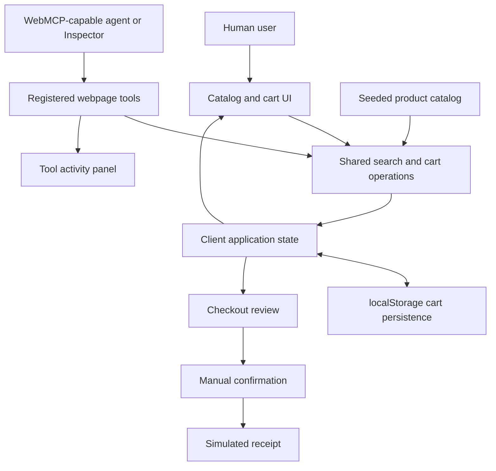

# Office Supply: WebMCP Webshop Demo Plan

Created: October 6, 2026
Project directory: `D:\projekti\WebMCP`
Status: Next.js foundation and initial manual webshop implemented locally on October 6, 2026. WebMCP integration and deployment are pending.

## Implementation Progress

- Milestone 1 complete: Next.js 16.3.8, React 19.3.0, TypeScript 7.0.2, Tailwind 4.3.3, shadcn/ui, Zod, Biome, Vitest, seeded catalog, and shared domain operations.
- Milestone 2 initial implementation complete: filters, product details, stock-validated cart, safe persistence, review, simulated receipt, and reset. Desktop and mobile browser smoke checks performed.
- View Transition API requested by the user: implemented through stable React 19.3 ViewTransition, with browser support checks and reduced-motion handling. Native animation playback remains to be verified in a supported browser.
- Milestones 3–5 pending: native WebMCP tools and activity panel, deployment, and article materials.
- All direct dependency versions were verified online; see `docs/dependency-versions.json` and README for setup and current limitations.

## Purpose

Build a small Next.js webshop and deploy it to Vercel as a practical example for a company knowledge base article about WebMCP.

The demo should show how an agent discovers and calls structured tools exposed by a webpage, and how those calls update the same application state used by the human-facing UI.

The reader should be able to open the hosted demo, follow browser setup instructions, repeat a documented scenario, and see both the tool calls and their effects.

## Recommended Demo Scenario

> I need equipment for two new colleagues: two wireless keyboards and two wireless mice, with a total budget of EUR 180. Choose the cheapest combination of in-stock products and prepare the order for review.

Expected flow:

1. The agent searches for wireless keyboards and mice.
2. It checks prices, stock, and the total cost for the requested quantities.
3. It adds the selected products to the cart.
4. It reads the resulting cart and verifies the budget.
5. It prepares a checkout summary.
6. The user reviews the summary and manually confirms a simulated order.

Use a clean cart at the start of the article walkthrough. Keep sufficient seeded stock and prices to make this scenario reproducible. The demo must also handle a budget that cannot be met without inventing products or prices.

## MVP Scope

### Product catalog

- 12–20 fictional office products across keyboards, mice, monitors, and accessories.
- Stable product IDs, names, categories, prices in EUR, stock quantities, connectivity, and concise specifications.
- Text search, category filter, maximum unit price, connectivity filter, and price sorting.
- Product details and an Add to cart action.
- Product images can use local illustrations or simple placeholders; external product services are unnecessary.

### Cart and checkout

- Add products, change quantities, remove products, and display totals.
- Apply the same quantity and stock validation to manual actions and agent calls.
- Store currency amounts as integer cents and calculate totals through shared domain functions.
- Persist the cart in localStorage with safe loading and a versioned data shape.
- A checkout review panel and a manual Confirm demo order action.
- Confirmation produces a local simulated receipt and clears the cart. No payment or actual order fulfillment.
- Any cart change invalidates the previous checkout summary; confirmation checks the current cart again.

### WebMCP visibility

- A support indicator: available, unavailable, or registration failed.
- A concise setup guide linked from the page.
- A collapsible Tool activity panel showing timestamp, tool name, arguments, result, and errors.
- A Reset demo action restoring the initial cart, receipt, and activity state for repeatable walkthroughs.
- Keep the main interface usable without WebMCP support.

### Out of scope for the MVP

- User accounts, shared databases, real stock management, payments, shipping, and email.
- A custom embedded AI chat, hosted model API keys, or a separate remote MCP server.
- Coupons, recommendation engines, admin dashboards, and cross-tab synchronization.
- Measured claims about token savings or speed improvements without a separate controlled evaluation.

## Technical Approach

- Next.js App Router and TypeScript, using supported versions verified when implementation starts.
- Vercel for hosting.
- A static seeded catalog and client-side cart state; the MVP does not require a database.
- A small application state layer with explicit cart operations. React context/reducer is sufficient initially.
- One shared set of domain operations consumed by both UI handlers and WebMCP tool handlers.
- Browser API access and tool registration belong in a client component after mount, never during server rendering.
- Validate tool arguments at runtime in addition to publishing JSON Schemas.



## Proposed Tool Contract

Finalize schemas and return formats against the current native WebMCP API before implementation. These are application-level tool names, not assumed browser API names.

| Tool | Inputs | Behavior / result |
| --- | --- | --- |
| `search_products` | Optional query, category, connectivity, maximum unit price in cents, in-stock filter, sort | Returns matching product summaries with stable IDs, prices, and stock; read only. |
| `get_product_details` | Product ID | Returns complete specifications, unit price, and stock; read only. |
| `add_to_cart` | Product ID and positive integer quantity | Adds that quantity after validating aggregate quantity against stock; returns the updated cart. |
| `set_cart_quantity` | Product ID and non-negative integer quantity | Sets an absolute quantity; zero removes the item; returns the updated cart. |
| `get_cart` | None | Returns lines, quantities, line totals, overall total, and currency; read only. |
| `prepare_checkout` | None | Validates the cart and opens a review summary; returns the summary and its revision. Does not confirm an order. |

Contract rules:

- Use explicit, narrowly scoped descriptions and schemas with supported enum values and numeric constraints.
- Return deterministic, compact data with IDs, integer-cent prices, currency, and meaningful errors.
- Define application error codes such as `PRODUCT_NOT_FOUND`, `INVALID_QUANTITY`, `INSUFFICIENT_STOCK`, and `EMPTY_CART`.
- Make mutation semantics explicit: adding is additive; setting quantity is absolute. Do not automatically retry additive mutations.
- Return success only after state is committed so the next tool call reads the updated cart.
- Register read-only annotations where supported. Treat annotations as descriptive hints, not validation or authorization.
- Do not expose localStorage access, arbitrary JavaScript execution, or simulated order confirmation as tools.
- Log actual tool executions, including failures. Label any manual tool execution as such rather than presenting it as an AI interaction.

## WebMCP Integration and Compatibility

The official Chrome documentation checked on October 6, 2026 uses `document.modelContext.registerTool()`. Older examples may use different API locations or signatures. Recheck the API, browser version requirements, and Inspector behavior before writing integration code.

- Feature-detect native support before registering tools.
- Register tools once per mounted integration owner and clean up according to the current API on unmount.
- Avoid duplicate registration during React development lifecycle checks and stale state captured by tool closures.
- Keep tools available across the catalog, cart, and checkout review within the demo route.
- Show clear setup guidance when support is unavailable rather than failing the ordinary webshop.
- Use the official Model Context Tool Inspector for discovery, manual execution, and the natural-language walkthrough.
- Document the exact browser version, flag/origin-trial setup, and Inspector version actually tested.
- For the initial public walkthrough, use documented browser testing setup. Consider an origin trial if its current availability and conditions fit the deployment.
- Hosting the site does not by itself enable WebMCP in a visitor's browser.
- Use native WebMCP for the first implementation. If a polyfill or bridge becomes necessary, document its role and test it separately.

The site exposes webpage tools. A capable agent or testing client discovers and invokes them; the site does not gain an autonomous agent merely by registering tools.

## Suggested Project Structure

```text
WebMCP/
  PLAN.md
  README.md
  package.json
  app/
    layout.tsx
    page.tsx
    globals.css
  components/
    catalog.tsx
    product-details.tsx
    cart.tsx
    checkout-review.tsx
    webmcp-status.tsx
    tool-activity.tsx
  lib/
    catalog.ts
    domain.ts
    validation.ts
    store.tsx
    webmcp.ts
  public/
    products/
  tests/
    domain.test.ts
    tool-contracts.test.ts
  docs/
    demo-walkthrough.md
    article-outline.md
```

This is a proposed structure, not a requirement to create every file immediately. Keep implementation proportional to the demo.

## Implementation Milestones

### 1. Scaffold and freeze the demo data

- Initialize the Next.js project in this directory.
- Set up TypeScript, linting, and suitable test tooling.
- Seed a catalog with a documented expected cheapest combination for the main scenario.
- Build shared search, cart, total calculation, and validation operations.

Acceptance: domain tests cover search constraints, integer-cent totals, quantity updates, missing products, and stock limits.

### 2. Build the human-facing webshop

- Implement catalog filtering, product details, cart, checkout review, and simulated receipt.
- Add localStorage persistence, demo reset, loading behavior, and accessible feedback.
- Ensure keyboard operation and useful layouts on desktop and mobile.

Acceptance: the complete scenario works manually, reload restores valid cart state, and invalid saved data is handled safely.

### 3. Expose and verify WebMCP tools

- Add schemas, tool handlers, lifecycle cleanup, support detection, and activity logging.
- Use the same domain operations as manual UI interactions.
- Verify registration and execution through the official Inspector in a supported browser.

Acceptance: tools are discoverable, schemas are accepted, mutations visibly update the UI, and sequential calls observe current state.

### 4. Validate and deploy

- Run lint, relevant tests, and the production build.
- Check manual interactions and native WebMCP integration locally.
- Deploy to Vercel using the user's project/account context.
- Repeat the main scenario on the hosted HTTPS origin and verify the actual browser setup.
- Record the deployment URL and tested environment in README.

Acceptance: the hosted demo is reproducible from the published instructions and works normally when WebMCP is unavailable.

### 5. Produce article materials

- Write the walkthrough and article outline in English.
- Capture screenshots of the catalog, tool activity, populated cart, and checkout review.
- Include a short, actual registration example from the final implementation.
- Document limitations, compatibility requirements, and how the demo differs from a remote MCP server.

## Validation Scenarios

1. Main scenario: two wireless keyboards and two wireless mice within EUR 180.
2. Unachievable budget: the agent explains the shortfall without adding a noncompliant selection.
3. Stock error: excessive quantity returns a useful error and leaves the cart unchanged.
4. Mixed interaction: the agent adds a product, the user changes its quantity, and the next `get_cart` sees the change.
5. Stale checkout: changing the cart after preparation invalidates the review and requires a fresh summary.
6. Empty cart: checkout preparation fails clearly.
7. Persistence: reload restores the cart; demo reset clears it predictably.
8. Compatibility: an unsupported browser still offers a functioning webshop and setup guidance.
9. Lifecycle: remounting the integration does not create duplicate tools or retain obsolete handlers.

## Company Knowledge Base Article Outline

Working title: **From Clicks to Tool Calls: WebMCP in a Next.js Webshop**

1. The problem: agents must otherwise infer how to interact with a site's UI.
2. What WebMCP exposes, where tools execute, and how it relates to MCP.
3. The Office Supply demo and the equipment-purchasing scenario.
4. Architecture: UI and tools share domain operations and application state.
5. Implementation: register a tool, define inputs, validate arguments, and return results.
6. Live walkthrough: discovery, search, cart changes, and checkout preparation.
7. User control: visible changes, meaningful errors, and manual order confirmation.
8. Browser setup, hosting, current limitations, and lessons learned.
9. Links to the hosted demo, source, and official documentation.

## Completion Criteria

- A working Next.js webshop hosted on Vercel.
- All six proposed tools implemented and exercised through native WebMCP.
- Manual and agent actions share the same validated operations and current state.
- Visible tool activity and a repeatable demo reset.
- No real purchases or private credentials required by the site.
- Tests, lint, and production build pass.
- README, demo walkthrough, article outline, and screenshots are ready for the company knowledge base.

## Official References

- [WebMCP overview, browser setup, and Inspector](https://developer.chrome.com/docs/ai/webmcp)
- [Imperative API](https://developer.chrome.com/docs/ai/webmcp/imperative-api)
- [Designing WebMCP workflows and tools](https://developer.chrome.com/docs/ai/webmcp/build-tools)
- [Official demo and tooling repository](https://github.com/GoogleChromeLabs/webmcp-tools)

## Next Session Handoff

Open `D:\projekti\WebMCP` as the workspace and read `PLAN.md` and `README.md`. Next, begin milestone 3: verify the current native WebMCP API and browser setup, expose all six tools through the existing validated domain operations, add the support indicator and activity panel, and ensure sequential tools read committed React state. Verify native view-transition playback in a supported browser. Complete Vercel deployment and article materials afterwards. The existing V7 Notes repository is unrelated to this demo and requires no changes.
